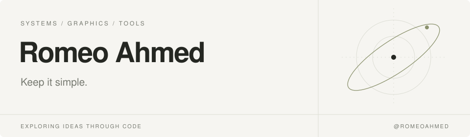

<picture>
  <source media="(prefers-color-scheme: dark)" srcset="assets/header-dark.svg">
  
</picture>

 

**I build tools to explore how things work.**

My projects explore machine instructions, composable shell pipelines, and light
around black holes. I work across systems programming, developer tools, and
graphics.

 

### Selected work

<table>
  <tr>
    <td width="26%" valign="top">
      <a href="https://github.com/romeoahmed/oplab"><strong>Oplab ↗</strong></a> 
      ASSEMBLY &amp; DEBUGGING
    </td>
    <td>
      A desktop assembly workbench for x86_64 and AArch64.
      Step through code, inspect registers and memory, and edit live machine state.  
      Rust · Tauri · Svelte &nbsp; / &nbsp; In development
    </td>
  </tr>
  <tr>
    <td valign="top">
      <a href="https://github.com/romeoahmed/rillsh"><strong>Rill Shell ↗</strong></a> 
      LANGUAGE &amp; SHELL
    </td>
    <td>
      A functional shell with structured data pipelines and reusable job plans.
      Compose functions and commands with explicit boundaries between bytes and values.  
      Rust &nbsp; / &nbsp; In development
    </td>
  </tr>
  <tr>
    <td valign="top">
      <a href="https://github.com/romeoahmed/nullray"><strong>Nullray ↗</strong></a> 
      GRAPHICS &amp; PHYSICS
    </td>
    <td>
      A browser observatory tracing light through Kerr–Newman spacetime.
      Explore gravitational lensing, accretion disks, and relativistic jets.  
      TypeScript · WebGPU &nbsp; / &nbsp; Optical prototype
    </td>
  </tr>
</table>

  <a href="https://github.com/romeoahmed?tab=repositories">Explore repositories ↗</a>

